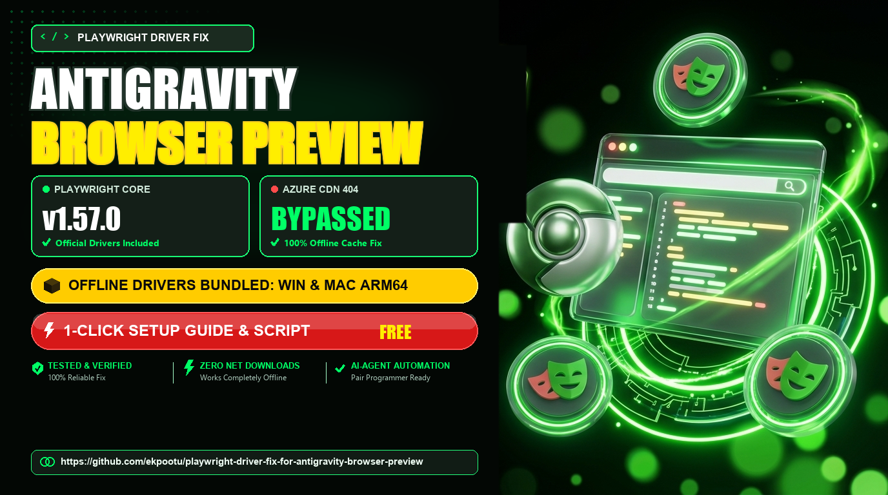

<div align="center">



# Playwright Driver Fix for Antigravity Browser Preview

[](https://opensource.org/licenses/MIT)
[](#)
[](https://github.com/microsoft/playwright)
[](#)
[](https://ekpootu.com)

**A complete, safe, and self-contained workaround for the Antigravity IDE Built-in Browser Preview failure on fresh installations.**

[Overview](#-overview) • [Root Cause](#-the-root-cause) • [Quick Start](#-quick-start) • [Offline Drivers](#-offline-driver-binaries) • [AI Automation](#-method-3-ai-agent-auto-fix) • [Harness Preflight](#️-antigravity-harness-bootstrap--preflight-integration) • [Author](#-author--acknowledgment)

</div>

---

## 📌 Overview

When setting up a fresh installation of **Antigravity IDE**, developers frequently encounter an issue where the **Built-in Browser Preview** fails to launch or hangs indefinitely.

This repository provides an automated, cross-platform resolution that restores the Browser Preview in seconds with **zero broken external downloads**. It includes official offline driver packages for Windows and macOS, automated PowerShell and Bash scripts, and a guided context prompt for AI agents.

---

## 🚨 The Root Cause

When Antigravity IDE initiates its Built-in Browser Preview, its internal Go-based Language Server invokes `playwright-go` to ensure required automation drivers are present in the local system cache:

* **Windows:** `%LOCALAPPDATA%\ms-playwright-go\1.57.0`
* **macOS:** `~/Library/Caches/ms-playwright-go/1.57.0`
* **Linux:** `~/.cache/ms-playwright-go/1.57.0`

By default, older Go server routines attempt to download the driver zip file (e.g., `playwright-1.57.0-win32_x64.zip`) from Microsoft's legacy Azure CDN endpoint:

```http
GET https://playwright.azureedge.net/builds/driver/playwright-1.57.0-win32_x64.zip
HTTP/1.1 404 Not Found
```

Because Microsoft has **permanently deprecated and decommissioned** the `*.azureedge.net` driver distribution structure, this request fails with an unrecoverable **404 Not Found** error, leaving an empty directory and preventing the preview server from initializing.

---

## 💡 The Solution

The Go Language Server only attempts the remote CDN download if its target cache directory is unpopulated. By provisioning the official driver runtime into the cache directory beforehand, the IDE recognizes the driver as fully installed and launches the browser preview immediately.

```
Antigravity IDE / CLI / Agent Harness
                 │
                 ▼
        Go Language Server
                 │
                 ▼
           playwright-go
                 │
                 ├── checks %LOCALAPPDATA%\ms-playwright-go\1.57.0
                 │
                 ▼
            Driver Exists
                 │
                 ├── node.exe (verified)
                 ├── package/
                 │     └── cli.js
                 │
                 ▼
          Install Chromium
                 │
                 ▼
   Browser Preview / open_browser_url
                 │
                 ▼
             ✅ WORKS
```

Instead of the failing CDN route:

```
playwright-go ──► Azure CDN (playwright.azureedge.net) ──► 404 Not Found ──► 💥 Browser Preview Failure
```

This repository resolves the issue using a **dual-resolution strategy**:
1. **Pre-Packaged Offline Driver:** Installs directly from the verified driver archives bundled inside [`Playwright-1.5.7.0-Drivers/`](./Playwright-1.5.7.0-Drivers) (includes standalone `node.exe` / `node` binary and `package/` files—requiring zero external internet downloads).
2. **Local IDE Resource Fallback:** If the zip archive is unavailable, the script locates the bundled `playwright-core` package already embedded within Antigravity IDE's internal `resources/app/node_modules/` directory and links the runtime.

---

## 🛠️ Quick Start

Choose the method that fits your environment:

### Method 1: Windows (1-Click PowerShell Script)

1. Clone or download this repository:
   ```powershell
   git clone https://github.com/ekpootu/playwright-driver-fix-for-antigravity-browser-preview.git
   cd playwright-driver-fix-for-antigravity-browser-preview
   ```
2. Open PowerShell and run the automated script:
   ```powershell
   .\Fix-PlaywrightDriver.ps1
   ```
   *(Optional: Use `.\Fix-PlaywrightDriver.ps1 -Force` to force a clean reinstallation).*
3. **Restart Antigravity IDE completely** (exit all open IDE windows and reopen).

---

### Method 2: macOS & Linux (1-Click Bash Script)

1. Clone or download this repository:
   ```bash
   git clone https://github.com/ekpootu/playwright-driver-fix-for-antigravity-browser-preview.git
   cd playwright-driver-fix-for-antigravity-browser-preview
   ```
2. Make the script executable and run:
   ```bash
   chmod +x Fix-PlaywrightDriver.sh
   ./Fix-PlaywrightDriver.sh
   ```
3. **Restart Antigravity IDE completely**.

---

### Method 3: AI Agent Auto-Fix (Pair Programming)

If you are working inside Antigravity IDE with an AI pair programmer (such as the built-in Antigravity Agent, Claude, Copilot, or Cursor):

#### Option A: Clone Repository First (Recommended for Local Workspaces)
1. Clone this repository onto your machine or into your active workspace:
   ```bash
   git clone https://github.com/ekpootu/playwright-driver-fix-for-antigravity-browser-preview.git
   ```
2. Open the AI chat panel in Antigravity IDE and provide the agent with the following prompt:
   > **"Please read the instructions in ./playwright-driver-fix-for-antigravity-browser-preview/Fix-AntigravityPlaywright.md and resolve my browser preview issue."**
3. The AI agent will read [`Fix-AntigravityPlaywright.md`](./Fix-AntigravityPlaywright.md), inspect your environment, verify the offline driver integrity, populate the local cache, and install Chromium automatically.
4. Restart Antigravity IDE completely once the agent confirms completion.

#### Option B: Zero-Step Direct Prompt (Autonomous Agent Auto-Fetch)
If you haven't cloned this repository beforehand, you can give your AI agent the GitHub repository URL directly in the chat:
> **"Use the solution proposed in https://github.com/ekpootu/playwright-driver-fix-for-antigravity-browser-preview.git to solve my Antigravity browser preview failure, populate the local Playwright Go cache, install Chromium, and verify the browser launch."**

The agent will autonomously clone the repository into a temporary directory, execute the verified preflight fix script, and validate browser launch for you.

---

### Method 4: Manual Setup (Step-by-Step)

If you prefer to configure the files manually without running automated scripts:

1. **Clone or Download the Repository:**
   ```bash
   git clone https://github.com/ekpootu/playwright-driver-fix-for-antigravity-browser-preview.git
   cd playwright-driver-fix-for-antigravity-browser-preview
   ```
   *(Alternatively, download the appropriate driver archive from the [GitHub Releases](https://github.com/ekpootu/playwright-driver-fix-for-antigravity-browser-preview/releases) page).*

2. **Configure Driver & Chromium Binaries:**

#### On Windows:
1. Create the target cache folder:
   ```powershell
   New-Item -ItemType Directory -Force -Path "$env:LOCALAPPDATA\ms-playwright-go\1.57.0"
   ```
2. Extract `Playwright-1.5.7.0-Drivers\playwright-1.57.0-win32_x64.zip` into `$env:LOCALAPPDATA\ms-playwright-go\1.57.0\`.
3. Verify that `$env:LOCALAPPDATA\ms-playwright-go\1.57.0\` contains `node.exe` and a `package\` folder containing `cli.js`.
4. Install Chromium browser binaries:
   ```powershell
   & "$env:LOCALAPPDATA\ms-playwright-go\1.57.0\node.exe" "$env:LOCALAPPDATA\ms-playwright-go\1.57.0\package\cli.js" install chromium chromium-headless-shell
   ```
5. Restart Antigravity IDE.

#### On macOS:
1. Create the target cache folder:
   ```bash
   mkdir -p "$HOME/Library/Caches/ms-playwright-go/1.57.0"
   ```
2. Extract `Playwright-1.5.7.0-Drivers/playwright-1.57.0-mac-arm64.zip` into `~/Library/Caches/ms-playwright-go/1.57.0/`.
3. Grant executable permissions:
   ```bash
   chmod +x "$HOME/Library/Caches/ms-playwright-go/1.57.0/node"
   ```
4. Install Chromium:
   ```bash
   "$HOME/Library/Caches/ms-playwright-go/1.57.0/node" "$HOME/Library/Caches/ms-playwright-go/1.57.0/package/cli.js" install chromium chromium-headless-shell
   ```
5. Restart Antigravity IDE.

---

## 📦 Offline Driver Binaries

The [`Playwright-1.5.7.0-Drivers/`](./Playwright-1.5.7.0-Drivers) folder contains verified, standalone driver packages built for official Playwright releases:

| File | Platform | Architecture | Size | SHA-256 Checksum | Contents |
| :--- | :--- | :--- | :--- | :--- | :--- |
| `playwright-1.57.0-win32_x64.zip` | Windows | x64 (64-bit) | ~36.2 MB | `9F447E15A3688397222588938E9D848B680C1A0582118B37970B383622D8DABD` | Standalone `node.exe`, `package/` runtime, licenses |
| `playwright-1.57.0-mac-arm64.zip` | macOS | Apple Silicon (M1–M4) | ~40.4 MB | `7FEE6872B7225A83FD1195F1542D884B128C284E90AEDCEDFA71A8E960B8447B` | Standalone `node` binary, `package/` runtime, licenses |

> **Note on GitHub Distribution:** Both archives are under GitHub's 50 MB tracking threshold and are committed directly to this repository for immediate offline cloning. They are additionally mirrored on the repository's [GitHub Releases](https://github.com/ekpootu/playwright-driver-fix-for-antigravity-browser-preview/releases) page for direct asset downloads.

---

## 🛡️ Antigravity Harness Bootstrap & Preflight Integration

### 💡 One Thing to Add to Your Harness (Architecture & Best Practices)

When deploying or integrating Antigravity IDE and CLI within an **automated AI-agent harness**, autonomous pair-programming pipeline, or multi-developer provisioning workflow, make the driver-cache check an official part of your **bootstrap preflight sequence**:

```
if Playwright 1.57.0 driver exists:
    continue
else:
    verify driver archive integrity (SHA-256)
    install bundled/offline driver
    install Chromium
    verify browser launch & CDP readiness
```

### Why Preflight Matters for Agent Harnesses

* **Zero 404 Exceptions:** A fresh developer machine or CI container never encounters the Azure CDN 404 failure.
* **Pinned Cryptographic Integrity:** Pinning driver archives by **SHA-256** ensures supply-chain reproducibility and protects the harness against corrupted or untrusted artifacts.
* **CDP Port Collision Remediation:** Detects and resolves TCP port `9222` conflicts (e.g., from background zombie browser processes) that trigger `open_browser_url failed with failed to create browser context: failed to resolve CDP URLs: get CDP version info: could not resolve IP for 127.0.0.1 / timed out`.

### 🚀 Automated Preflight Commands for AI Harnesses & CI/CD

**On Windows (PowerShell):**
```powershell
# Non-destructive preflight check (returns code 0 if ready, provisions if missing)
.\Fix-PlaywrightDriver.ps1 -Preflight

# Force clean provisioning and clear port 9222 collisions
.\Fix-PlaywrightDriver.ps1 -Force -ClearPortCollision
```

**On macOS & Linux (Bash):**
```bash
# Non-destructive preflight check
./Fix-PlaywrightDriver.sh --preflight

# Force clean reinstall
./Fix-PlaywrightDriver.sh --force
```

---

## 📂 Repository File Index

```
├── .gitignore                      # Standard repository hygiene exclusions
├── cover.png                       # High-resolution visual cover & social preview
├── design-theme-example.jpg        # Reference design & theme specification
├── Fix-AntigravityPlaywright.md    # Agent-optimized instructions for AI auto-fix
├── Fix-PlaywrightDriver.ps1        # Automated PowerShell fix script (Windows)
├── Fix-PlaywrightDriver.sh         # Automated Bash fix script (macOS & Linux)
├── LICENSE                         # MIT License
├── Playwright-1.5.7.0-Drivers/     # Standalone official driver archives
│   ├── playwright-1.57.0-mac-arm64.zip
│   └── playwright-1.57.0-win32_x64.zip
└── README.md                       # Comprehensive documentation
```

---

## 🧑‍💻 Author & Acknowledgment

This fix was researched, developed, and maintained by **Dr. Ekpo Otu**.

* **Website:** [https://ekpootu.com](https://ekpootu.com)
* **GitHub:** [@ekpootu](https://github.com/ekpootu)
* **Profile & Links:** [https://linktr.ee/ekpootu](https://linktr.ee/ekpootu)

Contributions, issues, and feedback are welcome!

---

## 📄 License

This project is licensed under the [MIT License](./LICENSE).
